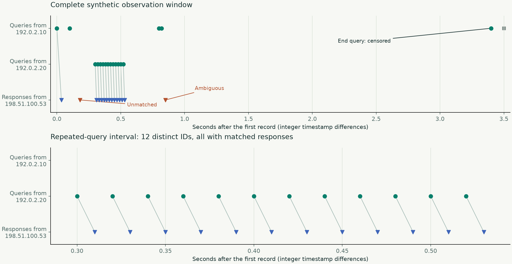

# Packet capture forensics lab

**[View the report in your browser](https://Michaelhoang8.github.io/packet-capture-forensics-lab/)**

A bounded, source-built reader for **classic PCAP → Ethernet → IPv4 → UDP → selected DNS**, with byte-offset provenance and a reproducible offline analysis study. It separates malformed, truncated and unsupported records, verifies the applicable checksums, and matches DNS observations conservatively.

All five PCAP files are generated locally from owned synthetic bytes. No socket is opened, no live traffic is captured, and no third-party packet data is used. Code, fixtures, analysis and documentation were created with AI assistance. This is a protocol engineering study, not a production IDS or a claim of malicious activity.

[Interactive byte inspector and report](docs/report.html) · [Original PCAP](results/published/captures/dns-observations.pcap) · [Decoded packet CSV](results/published/packets.csv) · [Issue offsets](results/published/issues.csv)



## Implementation

- Four classic-PCAP magic variants: both byte orders and microsecond/nanosecond timestamps, retained as exact integer nanoseconds.
- Explicit file, record, packet and DNS resource limits; record truncation stops parsing without attempting byte resynchronization.
- Ethernet type, IPv4 header/length/checksum/fragment checks, UDP length and IPv4 pseudoheader checksum validation.
- DNS label and compressed-name bounds, loop detection, backward-byte-offset restriction, expanded-name limits and bounded resource records.
- Exact flow + transaction ID + canonical question matching; strict-prior timestamps and an inclusive observation window.
- Separate unmatched responses, ambiguous responses, unanswered queries, right-censored queries and descriptive repeated-query windows.
- A browser byte inspector that reads preserved bytes rather than reconstructing packets. Field colors mark successfully decoded regions, and timestamps remain exact strings in JavaScript.

## Recorded evidence

The study parses five committed PCAPs containing 54 records. The main observation file has 17 queries and 15 responses: 13 unique matches, one unmatched response and one ambiguous response. Three queries have no unique response match in the declared two-second window; one remains right-censored at the end of the file.

Twelve queries for `repeated.test.` occur over 220 ms with distinct transaction IDs, and all twelve have matched responses. This pattern is reported without an attack label. The separate corruption fixture contains ten quarantined and four unsupported records, with exact fault offsets.

The precision fixtures preserve a 789 ns query/response difference in nanosecond PCAP. Their microsecond counterpart rounds both records to the same timestamp, so the matching rule declines to infer temporal order. [Findings](docs/findings.md) explain these limits.

## Run

Python 3.11 or newer; the recorded run used Python 3.13.17. The parser, analysis, CLI, fixture generation and tests use the standard library.

```sh
python -m pip install -e .
python -m unittest discover -s tests -v
python -m pcaplab results/published/captures/dns-observations.pcap
python -m pcaplab results/published/captures/corruption-cases.pcap --output decoded.json
```

The CLI emits decoded records, issues and analysis as JSON. Output files are created exclusively and will not be overwritten. Unsupported or invalid global headers fail with a reason and byte offset; packet-level issues remain visible in the returned capture evidence.

## Reproduce

```sh
python scripts/run_study.py --out outputs/reproduction
python -m pip install -r requirements.txt
python scripts/build_report.py
python -m http.server 8000
```

Open `http://localhost:8000/docs/report.html`. A fresh experiment refuses a nonempty output directory. Captures and decoded results are deterministic; new timings and execution timestamps are measured again. The report builder reads the preserved `results/published` run and does not resample it. Plot-only dependencies are NumPy 2.3.5 and Matplotlib 3.11.2.

CI runs the tests, generates a separate fresh experiment and compares its captures, decoded JSON, packet CSV, issue CSV and summary CSV with the committed evidence. It leaves the published run unchanged. Tests include literal wire vectors, independent checksum arithmetic, all four timestamp encodings at the maximum representable seconds/fraction, compressed and uncompressed 255-byte DNS names, 500 seeded mutations, correlation boundaries, CLI behavior and exact artifact reconciliation.

## Files

| Path | Contents |
|---|---|
| `src/pcaplab/core.py` | Bounded capture and protocol parsing, checksum validation and absolute offsets |
| `src/pcaplab/analysis.py` | Conservative observation matching and repeated-query windows |
| `scripts/fixtures.py` | Owned offline packet-byte construction with separate checksum arithmetic |
| `results/published/captures/` | Original synthetic PCAP bytes |
| `results/published/decoded/` | Full decoded layers, issues and correlation evidence |
| `results/published/packets.csv` | Record offsets, timestamps, endpoints, status and packet hashes |
| `results/published/issues.csv` | Fault category, reason and absolute byte offset |
| `results/published/measurements.csv` | 25 actual warmed parse-and-analysis timings |
| `docs/assets/inspector-data.json` | Exact displayed packet bytes and field ranges |
| `docs/protocols.md` | Primary references and explicit subset boundaries |
| `docs/methodology.md` | Matching assumptions, censoring, limits and provenance |

The parser is deliberately incomplete: no PCAPNG, VLAN, IPv6, TCP, fragment reassembly, IPv4 option interpretation, DNSSEC or EDNS semantics. DNS compression targets are structurally decoded at earlier byte offsets; the implementation does not prove they start at a previously parsed name/label boundary. Unknown DNS RDATA is length-checked and retained as an opaque-record count, not semantically validated. These limits are part of the reported contract.
